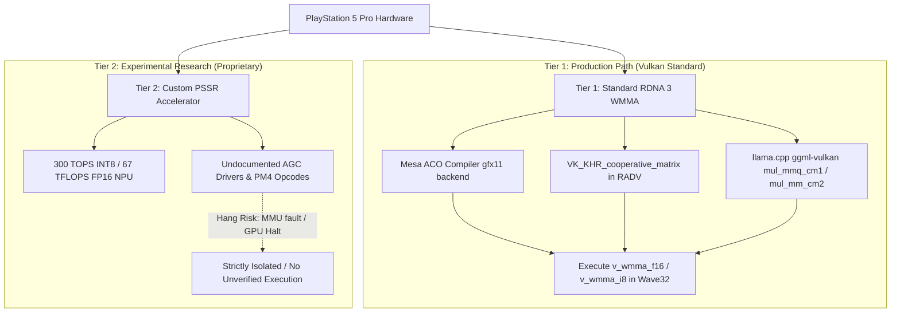

# PS5 Pro Machine Learning Acceleration & Hardware Notes

This document details the hardware differences between the standard PlayStation 5 (Base/Slim, Oberon) and the PlayStation 5 Pro (Viola / Trinity), the diagnostic data captured by PS5LM's console probe (`/data/PS5LM/probe.json`), and the two-tier architectural roadmap for accelerating LLM inference on PS5 Pro hardware.

> [!NOTE]
> Specifications listed as **Confirmed Specification** are hardware engineering parameters established by Sony and AMD.
> Benchmark figures and heap measurements labeled **(needs PS5 Pro console run)** are unverified placeholders reserved for physical measurements on jailbroken PS5 Pro hardware. Never fabricate console-measured numbers.

---

## 1. Confirmed Hardware Comparison

| Parameter | Base / Slim (`Oberon` / `CFI-1xxx` & `CFI-2xxx`) | PS5 Pro (`Viola` / `Trinity` / `CFI-70xx`) | Delta / Advantage for LLM Inference |
|---|---|---|---|
| **GPU Architecture** | AMD GC 10.1.3 (RDNA 2 + RT hybrid) | AMD Viola (RDNA 3/3.5 hybrid + RDNA 4 RT) | Dual-issue compute, RDNA 3 ISA, WMMA matrix cores |
| **Active Compute Units** | 36 CUs (40 physical, 4 disabled) | 60 CUs (64 physical, 4 disabled) | +66.7% shader cores (3,840 ALUs vs 2,304 ALUs) |
| **GPU Peak Boost Clock** | 2.23 GHz (dynamic) | 2.35 GHz (boost) | Higher clock ceiling |
| **FP32 TFLOPS (Vector)** | 10.28 TFLOPS | ~18.0 TFLOPS (classic) / ~33.5 TFLOPS (dual-issue) | ~1.75x–3.2x raw vector floating point throughput |
| **Unified Memory (VRAM)** | 16 GB 256-bit GDDR6 @ 14 Gbps | 16 GB 256-bit GDDR6 @ 18 Gbps | +28.6% raw memory bandwidth |
| **Memory Bandwidth** | 448 GB/s theoretical | 576 GB/s theoretical | Critical for autoregressive token generation decode speed |
| **OS Memory (DDR)** | 512 MB DDR4 (background OS) | 2 GB DDR5 (dedicated OS subsystem) | Frees unified GDDR6 memory previously held by system services |
| **Title Direct Memory Budget** | ~12.5 GB direct allocation (~11.44 GiB RADV heap) | ~13.7 GB direct allocation (~12.6–12.8 GiB expected) | **+1.2 GB** direct memory headroom for larger weights and context |
| **CPU Architecture** | 8-core / 16-thread AMD Zen 2 @ 3.5 GHz | 8-core / 16-thread AMD Zen 2 with 3.85 GHz boost mode | +10% CPU clock speed for host scheduling and CPU fallbacks |
| **Dedicated ML Hardware** | None (emulated / scalar integer) | Custom PSSR NPU: **300 TOPS INT8 / 67 TFLOPS FP16** | Hardware matrix acceleration |

---

## 2. Console Probing: Slim vs Pro (`/data/PS5LM/probe.json`)

PS5LM's diagnostic utility ("Probe this console" in the UI / `probes/memprobe`) writes a comprehensive snapshot to `/data/PS5LM/probe.json`. The following table details what the probe captures on a standard console versus what is anticipated on a PS5 Pro:

| Probe Field | Base / Slim Console (Measured, CFI-2015) | PS5 Pro (Anticipated / *needs PS5 Pro console run*) | Technical Relevance |
|---|---|---|---|
| `console_model` | `"CFI-2015"` (or `CFI-1xxx`) | `"CFI-70xx"` | Hardware generation detection via `sceKernelGetHwModelName` |
| `is_pro` | `false` | `true` | Automatic PS5 Pro identification (`CFI-7...` prefix) |
| `cpu_freq_mhz` | 3,500 MHz | 3,850 MHz *(needs console run)* | Zen 2 high-frequency CPU boost status |
| `direct_memory_size_bytes` | 12,884,901,888 (~12.0 GiB) | ~14,710,000,000 (~13.7 GB) *(needs console run)* | Total physical pool size reported by `sceKernelGetDirectMemorySize()` |
| `max_contiguous_direct_alloc_bytes` | 12,079,595,520 (11.25 GiB) | *(needs PS5 Pro console run)* | Largest contiguous physical block allocatable with 2 MiB alignment |
| `vulkan.device_name` | `"PlayStation 5 GPU"` | `"PlayStation 5 Pro GPU"` | Marketing name reported by patched RADV (`RADV_PS5_PRO` / Pro detection) |
| `vulkan.heaps[0].size_bytes` | 12,284,067,840 (11.44 GiB) | ~13.5–13.7 GB *(needs PS5 Pro console run)* | Size of `VK_MEMORY_HEAP_DEVICE_LOCAL_BIT` heap exposed to Vulkan |
| `vulkan.int_dot_product_4x8_signed` | `false` (default) / `true` (`RADV_PS5_INT_DOT=1`) | `true` (`RADV_PS5_INT_DOT=auto` / `1`) | `VkPhysicalDeviceShaderIntegerDotProductPropertiesKHR::integerDotProduct4x8BitPackedSignedAccelerated` |
| `vulkan.cooperative_matrix_supported` | `false` | `false` (until Tier 1 enabled) | `VK_KHR_cooperative_matrix` extension presence |
| `vulkan.subgroup_size` | 64 (min 32, max 64) | 64 (min 32, max 64) | Subgroup width reported by RADV |
| `vulkan.gpu_copy_bandwidth_gbps` | *(needs console run)* | *(needs PS5 Pro console run)* | Device-to-device buffer copy throughput (GB/s) |
| `cpu_bandwidth.read_3threads_gbps` | *(needs console run)* | *(needs PS5 Pro console run)* | Multithreaded AVX2 read bandwidth (1 and 3 threads, GB/s) |

---

## 3. Two-Tier Roadmap for PS5 Pro Machine Learning Acceleration

### 3.1 Tier 1: Standard RDNA 3 WMMA via `VK_KHR_cooperative_matrix`

The primary, safe, and portable path for accelerating matrix multiplication on PS5 Pro is using AMD's Wave Matrix Multiply-Accumulate (WMMA) instructions through the Vulkan extension `VK_KHR_cooperative_matrix`.

#### Hardware Instruction Support (RDNA 3 / Viola)
Viola's compute units support native wave32 WMMA instructions:
- `v_wmma_f32_16x16x16_f16`: 16x16x16 matrix multiply accumulating FP16 inputs into FP32 result.
- `v_wmma_f16_16x16x16_f16`: 16x16x16 matrix multiply accumulating FP16 inputs into FP16 result.
- `v_wmma_i32_16x16x16_iu8`: 16x16x16 matrix multiply for signed/unsigned INT8 weights (ideal for Q4/Q8 quantization).
- `v_wmma_i32_16x16x16_iu4`: 16x16x16 matrix multiply for INT4 weights.

#### Driver & Compiler Readiness
1. **Mesa ACO (`src/amd/compiler/aco_opcodes.py`, `aco_insert_NOPs.cpp`)**:
   - Upstream ACO in PS5_Mesa already has complete support for GFX11 WMMA instructions (opcodes `0x40` through `0x45`).
   - Instruction hazard prevention, register allocation, and RAW dependency tracking (`vgpr_written_by_wmma`) are already implemented.
2. **Pinned `llama.cpp` (`ggml-vulkan.cpp`)**:
   - The pinned version of `llama.cpp` already contains complete GLSL cooperative matrix compute shaders:
     - `mul_mmq_cm1.comp` (INT8 quantized GEMM)
     - `mul_mm_cm2.comp` (FP16 GEMM)
     - `flash_attn_cm1.comp` and `flash_attn_cm2.comp` (FlashAttention with cooperative matrix)
   - Shaders dynamically activate when the physical device reports `VK_KHR_cooperative_matrix` and suitable matrix properties.
3. **Required RADV Changes**:
   - Current PS5_Mesa configures the winsys with GC 10.1.3 traits (`FAMILY_NV`, GFX10.3).
   - Once Viola's GFX11 compute engine compatibility is verified, RADV can expose `VK_KHR_cooperative_matrix` by advertising supported matrix type tuples (`M=16, N=16, K=16`, `Scope=Subgroup`, `ComponentType=Float16/Int8`).

---

### 3.2 Tier 2: Custom PSSR 300 TOPS INT8 / 67 TFLOPS FP16 Accelerator

The PS5 Pro incorporates custom machine learning hardware developed specifically for PlayStation Spectral Super Resolution (PSSR), delivering **300 TOPS of INT8** and **67 TFLOPS of 16-bit floating point** performance.

#### Operating Environment & Memory Footprint
- In commercial games, PSSR operates as a temporal upscaling pipeline managed by Sony's proprietary `libSceAgc` / `libScePsSr` runtimes.
- Games must allocate a static memory footprint of approximately **250 MB** for PSSR frame buffers, weight caches, and intermediate feature maps.
- **In PS5LM**, the console runs in title mode without a game engine. This ~250 MB footprint is completely free and available for direct LLM model weights.

#### Architectural Obstacles & Execution Risks
- **Undocumented Instruction Set**: The PSSR hardware does not expose standard AMD ROCm, RDNA 3, or Vulkan compute interfaces. It is driven via proprietary PM4 command packets and custom AGC dispatch calls.
- **Hardware Hang Risk**: Attempting to execute unverified or guessed instruction opcodes directly on the compute pipeline risks putting the GPU into an unrecoverable fault state:
  - `VK_ERROR_DEVICE_LOST`
  - Memory Management Unit violation (`MEMVIOL`)
  - Fatal GPU lockup requiring a physical console power cycle.
- **Project Policy**: **No blind fuzzing or executing unknown opcodes.** PS5LM will evaluate Tier 2 acceleration exclusively if and when sanitized, verified dispatch documentation or SDK headers for the PSSR hardware become available.

---

## 4. Immediate Practical Benefit on PS5 Pro Without New Shaders

Even prior to enabling Tier 1 WMMA or Tier 2 PSSR accelerators, running PS5LM on a PS5 Pro yields immediate performance advantages:

1. **Memory Bandwidth Bottleneck Relief (+28.6% decode speed)**:
   LLM token generation (autoregressive decoding) is strictly memory-bandwidth bound. Upgrading from 448 GB/s (Slim) to 576 GB/s (Pro) translates directly into a ~25–28% higher generation tok/s ceiling on memory-bound models (e.g. Qwen 3.5 9B and Qwen 3.8 27B).
2. **Additional Title Memory (+1.2 GB)**:
   The dedicated 2 GB DDR5 OS RAM frees 1.2 GB of unified GDDR6 memory. The available direct memory expands from 12.5 GB to ~13.7 GB, allowing:
   - Qwen 3.8 27B UD-IQ2_XXS to run with substantially larger context windows (e.g., expanding from 4k to 8k–16k).
   - MoE models (e.g., Mixtral 8x7B heavily quantized or Qwen 2.5 14B) to fit without exceeding title direct memory limits.
3. **Prompt Processing Throughput (+66.7% compute)**:
   Prompt evaluation (prefill) is compute-bound. 60 CUs at 2.35 GHz significantly accelerate prompt ingestion speed, which is further multiplied when `RADV_PS5_INT_DOT=auto` activates INT8 dot product instructions.
