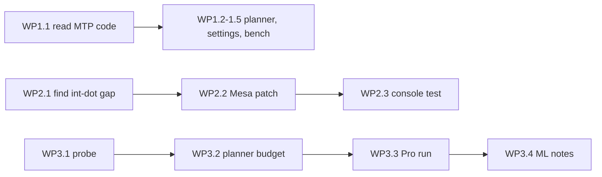

# Plan: speculative decoding, integer dot product, PS5 Pro probing

Implementer: Gemini Flash, high reasoning. One work package (WP) at a time, in
the order below. Each WP ends at a **STOP** checkpoint: report back and wait.
Background: the discussion that produced this plan, and
[RESEARCH.md](../RESEARCH.md), [CONSOLE.md](../CONSOLE.md), [ROADMAP.md](../ROADMAP.md).

## Rules for the implementer

- Do not upgrade or re-pin `third_party/llama.cpp` (pinned at `04f7226`), PS5_Mesa
  (`1ba9874` plus `patches/mesa`) or any other dependency.
- Changes to llama.cpp go in a new numbered file in `patches/` (next free number
  `0013-...`), never as edits inside the submodule left uncommitted. The same goes
  for Mesa: new files in `patches/mesa/` (next free number `0010-...`).
- No commits, pushes, releases, console deployment or model downloads unless
  the user asks. Host builds and host tests only; write output under `build/`.
- Never write a performance number you did not measure. Anything that needs a
  console says **needs console** and is handed to the user as a script plus
  instructions.
- Keep existing comments and docstrings. Match the style of nearby code
  (C++20, 4-space indent, `ps5lm` namespace, short plain-English comments).
- Each WP report lists: files changed, decisions, commands run and their
  output summary, what is unverified, open questions.

## Key facts to start from (verified on 2026-11-03)

- The pinned llama.cpp already has speculative decoding with draft models
  (`-md` / `--spec-draft-model`, `--draft-max`, `--draft-min`,
  `--spec-draft-ngl`) and an MTP type `COMMON_SPECULATIVE_TYPE_DRAFT_MTP`
  (`common/common.h:178`), selected with `--spec-type` (`common/arg.cpp:4284`)
  or `--mtp` (`common/arg.cpp:3097`). It discovers an MTP head as a
  **sidecar file** (`plan_spec.mtp`, `common/arg.cpp:540-590`), and has a
  `load_mtp` flag for MTP/NextN layers inside the main GGUF.
- The app builds llama-server arguments in the planner:
  `ps5/app/model_plan.cpp` → `Plan::args` (`model_plan.hpp:78-92`), launched by
  `ps5/app/main.cpp` (`llama_server(argc, argv)`, around line 593, extra args
  around line 742).
- User settings: `ps5/app/settings.hpp` / `settings.cpp`, stored in
  `/data/PS5LM/settings.json`; unknown keys keep defaults. Tests:
  `settings_test.cpp`, `model_plan_test.cpp`, run via `scripts/test-host.sh`.
- ggml-vulkan's integer-dot path is enabled only when the device reports
  `VK_KHR_shader_integer_dot_product`
  (`third_party/llama.cpp/ggml/src/ggml-vulkan/ggml-vulkan.cpp`, around lines
  10-26). PS5_Mesa's RADV does not report it today.
- Device memory for the title on a Slim: 12 GiB direct memory, 11.44 GiB
  RADV heap. Pro values are unknown.

---

## WP1: Speculative decoding in the planner (host only)

Goal: the app can launch a model with an MTP head or a draft model, and the
planner counts their memory. Off by default.

### 1.1 Find out exactly how MTP is loaded (read, no code)

1. Read `common/arg.cpp` around lines 290-660, 3090-3205 and 4270-4290, and
   `common/speculative.h` / `common/speculative.cpp`, in the pinned submodule.
2. Answer in the report:
   - Does `--spec-type draft-mtp` (check the exact string from
     `common_speculative_all_types_str()`) read MTP layers **from the main
     GGUF**, from a **sidecar GGUF**, or either?
   - How is a local sidecar named/found (not via Hugging Face download)? Is
     `-md <file>` with `--spec-type draft-mtp` the local way?
   - Which architectures support MTP in `src/llama-model.cpp` (search
     `nextn` / `mtp`). Is `qwen35` (used by Qwen 3.8 27B GGUFs) one of them?
   - Which GGUF metadata key tells that a file has MTP layers (look in
     `src/llama-arch.cpp` for `nextn_predict_layers` or similar).
3. If `qwen35` has no MTP support in the pinned version: **STOP** and report;
   continue WP1 with draft models only.

### 1.2 Read MTP and draft info from GGUF headers

Files: `ps5/app/model_plan.hpp`, `model_plan.cpp`, `model_plan_test.cpp`.

1. Add to `ModelInfo`:
   - `uint32_t n_mtp_layers = 0;` from the key found in 1.1
     (`<arch>.nextn_predict_layers` or whatever it is).
   - `uint64_t mtp_bytes = 0;` the size of those layers' tensors if the tensor
     directory is parsed; otherwise estimate as
     `file_bytes / n_layer * n_mtp_layers` and comment that it is an estimate.
   - `std::string mtp_sidecar;` path of a sidecar MTP file beside the model,
     if 1.1 found that naming exists (mirror `find_mmproj`).
2. Add `std::string find_draft(const std::string & model_path)`: not needed
   yet if the user picks a draft by hand; skip unless trivial.
3. Tests with synthetic GGUF headers (follow the existing fixtures in
   `model_plan_test.cpp`): key present / absent / malformed.

### 1.3 Planner support

1. Extend `plan_model` with a new trailing parameter (keep old calls
   compiling): `const SpecOptions * spec = nullptr`, where

   ```cpp
   struct SpecOptions {
       std::string mode;        // "off", "mtp", "draft"
       std::string draft_path;  // for "draft"
       uint64_t    draft_bytes = 0;
       uint32_t    draft_max = 8;   // tokens drafted per step
       uint32_t    draft_min = 1;
   };
   ```

2. In memory accounting add `spec_gib`:
   - `mtp`: `mtp_bytes` (already inside `file_bytes` if the layers are in the
     main GGUF; then only extra KV/compute) + KV cache for the MTP layers at
     the chosen context + a fixed compute reserve (start at 128 MiB, mark it
     as a guess to be measured).
   - `draft`: draft weights + draft KV at the same context (use
     `kv_bytes_per_token` on the draft's `ModelInfo`) + 128 MiB.
   - Shrink context before refusing, as the planner already does for KV.
   - If it still does not fit, plan **without** speculation and set `why` to
     say so. Never fail a model only because speculation did not fit.
3. Append arguments (exact names verified in 1.1):
   - `mtp`: `--spec-type <mtp-type>` (plus `-md <sidecar>` if a sidecar),
     `--draft-max N --draft-min M`.
   - `draft`: `-md <path> --spec-draft-ngl 999 --draft-max N --draft-min M`.
4. Add `Plan::spec_gib` and `Plan::spec_mode` and show them in the planner's
   one-line `why`.
5. Tests: fits with spec; spec dropped when tight; context shrinks before
   spec is dropped; old calls (no `spec`) produce byte-identical `args` to
   before (compare with a golden vector from the current code).

### 1.4 Settings and UI

Files: `settings.hpp`, `settings.cpp`, `settings_test.cpp`, `dashboard.cpp`,
`main.cpp`.

1. Settings: `std::string speculative = "off";` (`"off"`, `"auto"`, `"draft"`),
   `std::string draft_model;`, `uint32_t draft_max = 8;`. `"auto"` means MTP
   when the model has it, else off. Round-trip and missing-key tests.
2. `main.cpp`: build `SpecOptions` from settings before calling `plan_model`.
   For `"draft"`, read the draft's `ModelInfo`; refuse a draft whose
   tokenizer differs (compare `tokenizer.ggml.model` and vocab size from the
   header; add them to `ModelInfo` if missing).
3. Dashboard Settings page: one row "Speculative decoding" with the three
   choices, in the same category style as "KV cache". A draft model is picked
   from the library list, filtered to files under 1.6 GB.
4. Home page: when speculation is on, show the draft acceptance rate. Check
   whether llama-server's `/metrics` (already enabled, `main.cpp:743`) or the
   `timings` of each response expose draft accepted/total counts; use what
   exists, do not add server patches in this WP.

### 1.5 Benchmark support

File: `scripts/benchmark-ps5lm.py`, `tests/test_benchmark_ps5lm.py`,
`docs/BENCHMARKING.md`.

1. Record the server's draft statistics per trial if present in responses
   (`timings.draft_n`, `timings.draft_n_accepted` or whatever the pinned
   server emits; grep `tools/server` for `draft_n`).
2. Add a prompt set with code and with free prose, because acceptance
   differs a lot between them.

### Acceptance (host)

- `scripts/test-host.sh` passes, including new tests.
- `scripts/test-native-build.sh` (or the documented build) still compiles
  the app.
- Golden test proves unchanged arguments when speculation is off.

### Console test script (needs console, for the user)

Write `docs/BENCHMARKING.md` section "Speculative decoding" with the exact
runs: Qwen 3.5 9B alone vs with Qwen 3.5 0.8B draft; Qwen 3.8 27B with and
without MTP; each on the code and prose prompt sets; `draft_max` 4, 8, 16.
Record tok/s, acceptance rate, peak free memory.

**STOP: report WP1.**

---

## WP2: Integer dot product in PS5_Mesa (host build, console test)

Goal: RADV on the PS5 reports `VK_KHR_shader_integer_dot_product` so
ggml-vulkan uses its integer (MMQ) shaders, which mainly speeds up prompt
processing.

### 2.1 Find why it is missing (read, no code)

1. Get the PS5_Mesa source as `patches/mesa/README.md` describes
   (`.deps/src/PS5_Mesa` at `1ba9874`). If `.deps` is absent, write down the
   fetch commands from `scripts/build-app.sh` and **STOP** to ask the user to
   run them (they may need network and a Linux host).
2. In `src/amd/vulkan/radv_physical_device.c`, find where
   `KHR_shader_integer_dot_product` is set in the extension table and what
   condition guards it (upstream: GFX level and/or ACO support).
3. In the PS5 winsys (`src/amd/vulkan/winsys/ps5/` or as named in the fork,
   search `ps5` under `src/amd/vulkan`), find how `radeon_info` is filled:
   `gfx_level`, `family`, `has_accelerated_dot_product` (name may differ;
   search `dot_product` in `src/amd/common/ac_gpu_info.c`).
4. Report which field is wrong or missing. Expected outcome: the PS5 winsys
   fills `radeon_info` by hand and leaves the dot-product flag false, or the
   family is set to something that upstream does not map.

### 2.2 Patch

1. Write `patches/mesa/0010-radv-ps5-report-integer-dot-product.patch`
   (`git format-patch` style, like 0007-0009) with the smallest change that
   sets the flag for the PS5 GPU (gfx10.3 has `v_dot4_i32_i8`,
   `v_dot4_u32_u8`, `v_dot2_*`).
2. Gate it behind an environment variable for the first console tests,
   default **off**: `RADV_PS5_INT_DOT=1`, read the same way 0009 reads
   `RADV_PS5_WAIT_SPIN_US`. Env vars go in `/data/PS5LM/env.txt`.
3. Update `patches/mesa/README.md` with a bullet for 0010.
4. Build RADV per the README command on a Linux host. If you cannot build,
   say so; do not claim it compiles.

### 2.3 Console validation script (needs console, for the user)

Write steps in `docs/BENCHMARKING.md` section "Integer dot product":

1. With `RADV_PS5_INT_DOT=1`: check that the llama log
   (`/data/PS5LM/llama.log`) shows ggml-vulkan's device line with
   `int dot: 1` (check the exact wording in `ggml-vulkan.cpp`).
2. Correctness first: build and run llama.cpp's `test-backend-ops -o MUL_MAT`
   for the console, or, if that is not practical, compare greedy outputs
   (temperature 0, fixed seed) of a 512-token prompt with the flag off and on;
   they must match or differ only by tiny logit noise (use `/v1/introspect`
   top-k to compare).
3. Then speed: prompt tok/s on a 2,000-token prompt and decode tok/s, for
   Qwen 3.5 9B Q4_K_M and Q4_0, and Qwen 3.8 27B, flag off vs on.
4. Failure modes to watch: `VK_ERROR_DEVICE_LOST`, console freeze (hold the
   power button), wrong text. Any of these: flag stays off, report.

### Acceptance

- Patch applies cleanly on `1ba9874` + 0007-0009 (`git am --3way` check).
- Flag off: driver behaviour unchanged (by reading the diff).
- Default-on only after the console results are reviewed by the user.

**STOP: report WP2.**

---

## WP3: PS5 Pro memory and bandwidth probing

Goal: measure, on a Pro, the memory a title gets and the bandwidth it sees,
and let the planner use measured budgets instead of the Slim's.

### 3.1 In-app probe (host build)

Files: new `ps5/app/probe.cpp` / `probe.hpp`, `main.cpp`, `dashboard.cpp`.

1. A Diagnostics action "Probe this console" that writes
   `/data/PS5LM/probe.json` with:
   - console model (read through the same calls `stats.cpp` uses, or
     `sceKernelGetHwModelName` if the SDK has it; check the SDK headers);
     firmware version;
   - `sceKernelGetDirectMemorySize()`;
   - largest direct-memory allocation that succeeds, by halving from the
     reported size in 256 MiB steps, freeing each time (use the recipe in
     RESEARCH.md: 2 MiB alignment, address hint away from the GPU window);
   - Vulkan: device name, `VkPhysicalDeviceMemoryProperties` heaps, the
     extension list, `VkPhysicalDeviceShaderIntegerDotProductProperties` if
     present, subgroup size;
   - a GPU bandwidth test: a compute shader that copies a 1 GiB buffer 10
     times, timed with timestamp queries; report GB/s. (Reuse ggml-vulkan's
     device if it is simpler; otherwise a small standalone Vulkan setup.)
   - a CPU bandwidth number from `probes/bwprobe/main.c` logic, moved into a
     function.
2. Run the probe only when the user asks and only with no model loaded.
   It must free everything it allocated; then restart the app via the
   existing LoadExec path, because freed GPU memory is not fully returned
   (see CONSOLE.md "Switching models").
3. Host test: JSON writer only (the hardware calls are not testable on host).

### 3.2 Planner uses the measured budget

1. The planner already takes `budget_gib` from ggml's free memory. Check
   that nothing in `model_plan.cpp`, `suggested.hpp` or `market.cpp` hard-codes
   11.4 / 12 GiB or Slim-only limits; replace any with the live value.
2. The Suggested list (`suggested.hpp`): allow an entry per console model
   later, but do not add Pro entries until measured.

### 3.3 Console run (needs a PS5 Pro, for the user)

1. Run "Probe this console" on a Pro and a Slim; send both `probe.json`.
2. Add results to `docs/CONSOLE.md` under a new "PS5 Pro" section, only with
   measured numbers.

### 3.4 ML hardware (research only, no code)

Not for this implementer to build. Write `docs/PRO_ML_NOTES.md` with:

1. What the probe's Vulkan dump shows on Pro vs Slim (device ID, extensions).
2. A list of what would be needed to use the Pro's ML units through RADV
   (identify opcodes, ACO support, `VK_KHR_cooperative_matrix`), with the
   risk that unknown opcodes hang the GPU.
3. No experiments that execute unknown opcodes.

**STOP: report WP3.**

---

## Order and dependencies



WP1, WP2 and WP3 touch different files except `docs/BENCHMARKING.md`
(WP1, WP2) and `main.cpp` / `dashboard.cpp` (WP1, WP3); do them one after
another, not in parallel.

## Out of scope

- Writing new GPU kernels, hand-written AGC kernels, or replacing llama.cpp.
- Upgrading llama.cpp to get newer speculative features.
- Turning any new feature on by default before console measurements.
